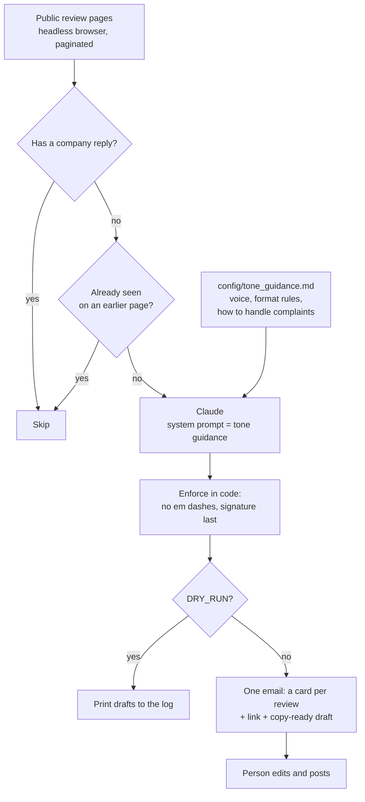

# Review Reply Drafts: every unanswered customer review, with a reply drafted in the company's voice, in one weekly email

A weekly job that finds the reviews of a company that have no company reply yet, has Claude draft a reply to each one from written tone guidance, and emails the whole batch as copy-ready cards with a link to each review. A person reads, edits and posts them. Nothing is posted automatically.

## The problem

Replying to reviews matters and is easy to let slide. Positive ones go unanswered because there is no urgency, and negative ones because they take thought. A month later there are thirty of them.

Automating the replies outright is the wrong fix. A public reply to an unhappy customer is the kind of text that should be read by a person before it goes out. The slow part is not the posting, it is finding which reviews are unanswered and writing a first draft that sounds like the company and follows its rules. That part can be done by a job.

## What it does

`src/reply_to_reviews.py` runs every Monday:

1. Opens the company's public review pages in a headless browser and reads the review data embedded in each page, following pagination.
2. Keeps the reviews that have no company reply, without duplicates.
3. Sends each one to Claude with the tone guidance as the system prompt.
4. Enforces the house rules on every draft in code: no em dashes, signature on the last line.
5. Emails one message with a card per review: stars, reviewer, date, the review, a button to open it, and the draft in a copy-ready block. A plain-text version is included.

## Architecture



## Key design decisions

**Drafts, not posts.** The job stops at an email. A person decides what is published under the company's name, and each card links straight to the review so posting takes a few seconds.

**The voice is a document, not code.** Format rules, tone, and how to handle complaints, refunds and sensitive topics live in a Markdown file that is used as the system prompt. Whoever owns customer service can change the voice without touching the script.

**Rules that must hold are enforced after generation.** The model is told the signature and the punctuation rules, and the code applies them anyway: em dashes are replaced and a missing signature is appended. A rule that only lives in a prompt will eventually be broken.

**Unreplied is read from the data.** Each review carries a reply object once the company has answered. The job uses that field, so it needs no memory of its own and a reply posted by hand is respected on the next run.

**A quiet week still sends an email.** With nothing to answer, the job sends a short "no unreplied reviews" message. Silence would look the same as a broken run.

**Failures are loud and partial work is kept.** A page that fails to load is retried once. If the review data never appears, the run fails with a message saying so. A draft that fails does not stop the others; they are still emailed, and the run exits non-zero so the failure shows in the workflow.

**Missing configuration is reported all at once.** Every missing variable is listed in one message before anything runs.

**Review text is escaped.** Titles, bodies and names are escaped before they go into the HTML email.

Two things to know before running it. It reads public pages with a browser, which is unofficial: check the review platform's terms, and prefer its API where your plan includes one. And the drafts are only as good as the tone guidance. The example file asks the model to acknowledge the customer's experience, promise nothing it cannot deliver, and move the details to support.

## Repository layout

```
src/reply_to_reviews.py            page reader, drafting, house rules, email
config/tone_guidance.example.md    example voice and complaint-handling rules
scripts/test_drafts.py             offline tests for parsing, reply finishing and the email
.github/workflows/                 weekly run
```

## Setup

Requires Python 3.10+, an Anthropic API key, and a mailbox with SMTP access.

```bash
pip install -r requirements.txt
playwright install chromium
python scripts/test_drafts.py                                  # offline, no keys needed
cp .env.example .env                                           # fill in values
cp config/tone_guidance.example.md config/tone_guidance.md     # your voice and rules
DRY_RUN=true python src/reply_to_reviews.py                    # print drafts, send nothing
python src/reply_to_reviews.py
```

| Variable | Purpose |
|---|---|
| `ANTHROPIC_API_KEY`, `CLAUDE_MODEL` | Drafting |
| `REVIEW_DOMAIN` | The company's domain on the review site |
| `SMTP_HOST`, `SMTP_PORT`, `SMTP_USERNAME`, `SMTP_PASSWORD`, `EMAIL_TO` | Sending the drafts |
| `COMPANY_NAME`, `REPLY_SIGNATURE` | Shown in the email and appended to every reply |
| `DRY_RUN` | `true` prints drafts to the log and sends nothing |
| `CONFIG_DIR` | Override the `config/` location |

Scheduled runs are off by default. Set the repository variable `ENABLE_SCHEDULE` to `true` to turn the schedule on; manual runs from the Actions tab always work.

---

Extracted from a production automation suite I built and ran for a live e-commerce and B2B wholesale business, 2026.

© Michael Wootan. Source shared for portfolio review; all rights reserved.
